# NEXUS

**From Future-Ready to Impact-Ready** — web app (PWA) yang memandu mahasiswa dari *mengenali potensi* sampai *punya proyek berdampak*, dalam 5 langkah yang datanya saling nyambung:

**KNOW → GROW → CONNECT → CREATE → IMPACT**

Dibangun dengan **Next.js 15 + MongoDB** oleh Team ARUNA · STMIK Widya Utama untuk PIMNAS 6 2026.

<p align="center">
  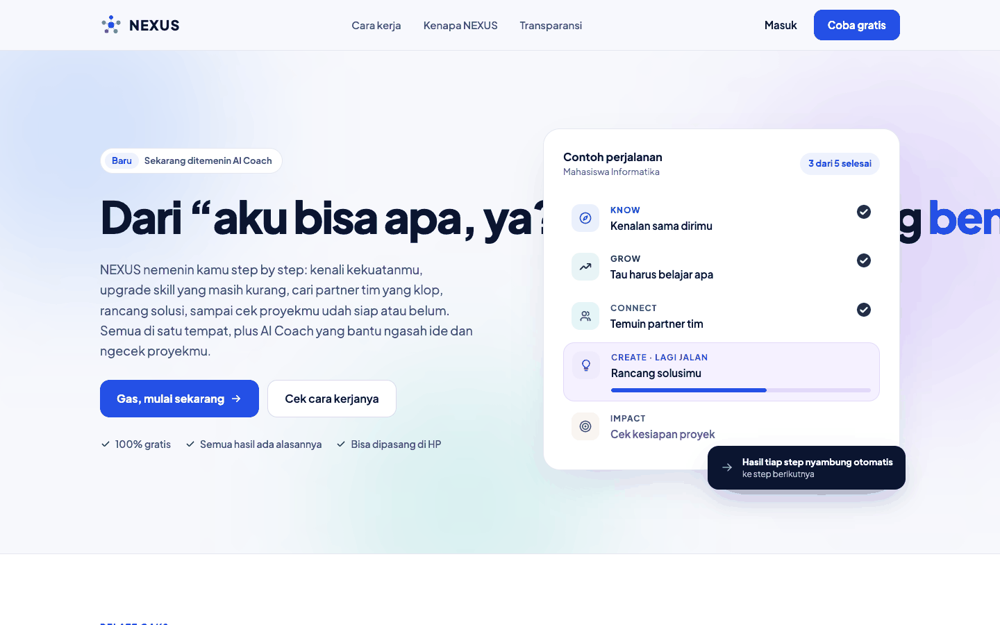
</p>

---

## Daftar isi
- [Tampilan](#tampilan)
- [Masalah, tujuan, dan prinsip produk](#masalah-tujuan-dan-prinsip-produk)
- [Target pengguna](#target-pengguna)
- [Lima langkah perjalanan](#lima-langkah-perjalanan)
- [Status kebutuhan PRD](#status-kebutuhan-prd)
- [Arsitektur & teknologi](#arsitektur--teknologi)
- [Model data](#model-data-mongodb)
- [API](#api)
- [Rumus penilaian](#rumus-penilaian)
- [AI Coach](#ai-coach)
- [Privasi, keamanan, aksesibilitas, PWA](#privasi-keamanan-aksesibilitas-pwa)
- [Menjalankan secara lokal](#menjalankan-secara-lokal)
- [Pengujian](#pengujian)
- [Struktur proyek](#struktur-proyek)
- [Penyimpangan dari PRD](#penyimpangan-dari-prd)
- [Belum dikerjakan & risiko](#belum-dikerjakan--risiko)

---

## Tampilan

Semua gambar diambil dari aplikasi yang berjalan, dengan **data fiktif** (`npm run docs:screenshots`).

| Dashboard | KNOW · skill populer di bidangmu |
| :---: | :---: |
| 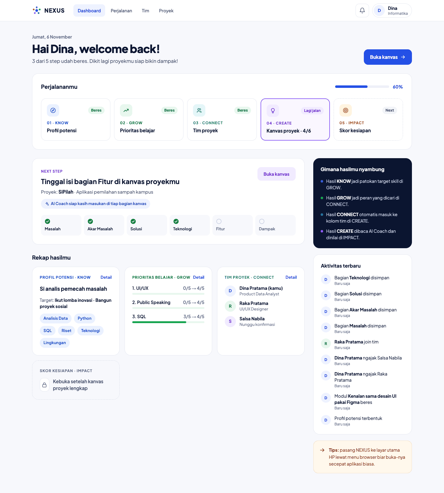 | 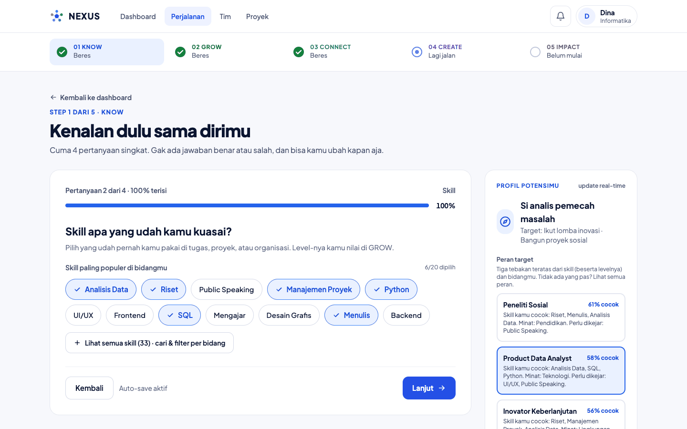 |
| **KNOW · menilai level skill** | **KNOW · peran target + alasan** |
| 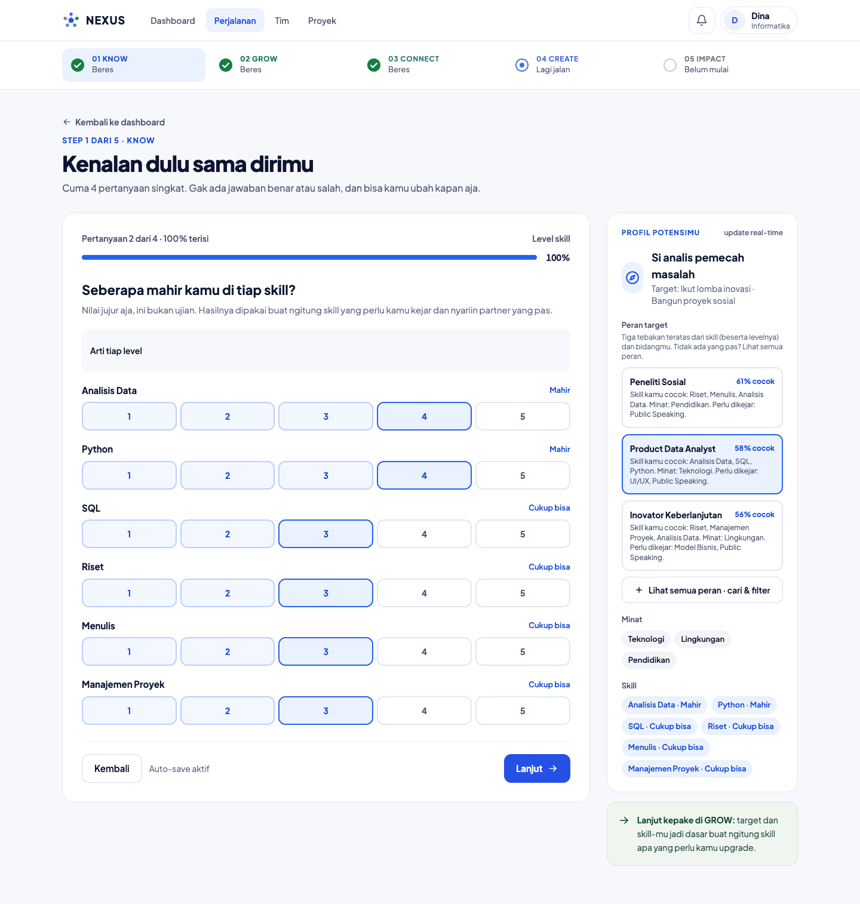 | 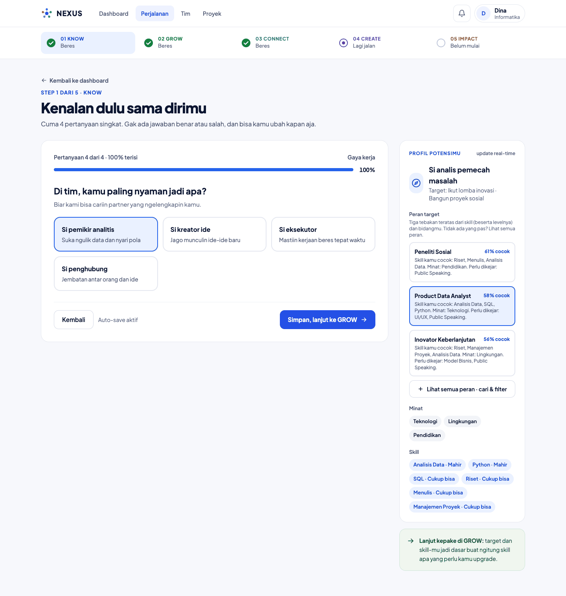 |
| **Semua skill · cari & filter bidang** | **GROW · skill gap & rencana belajar** |
| 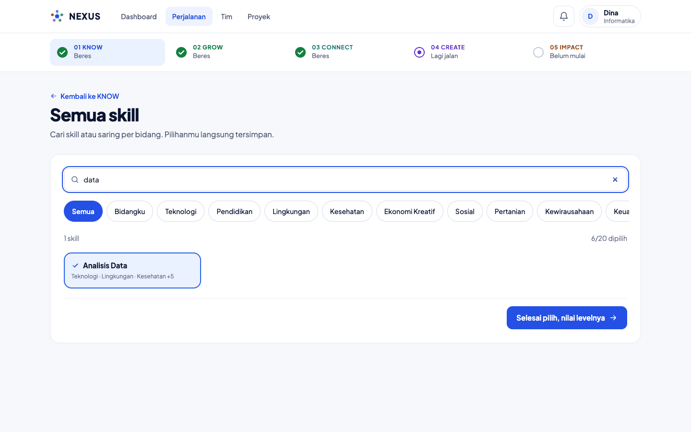 | 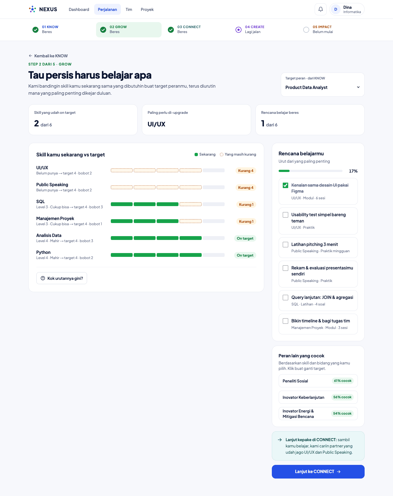 |
| **CONNECT · partner & alasan "kenapa klop"** | **CREATE · kanvas + template & contoh** |
| 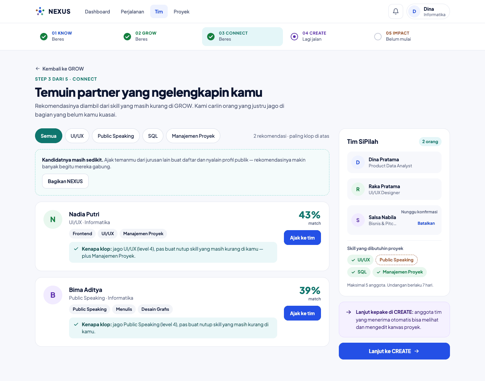 | 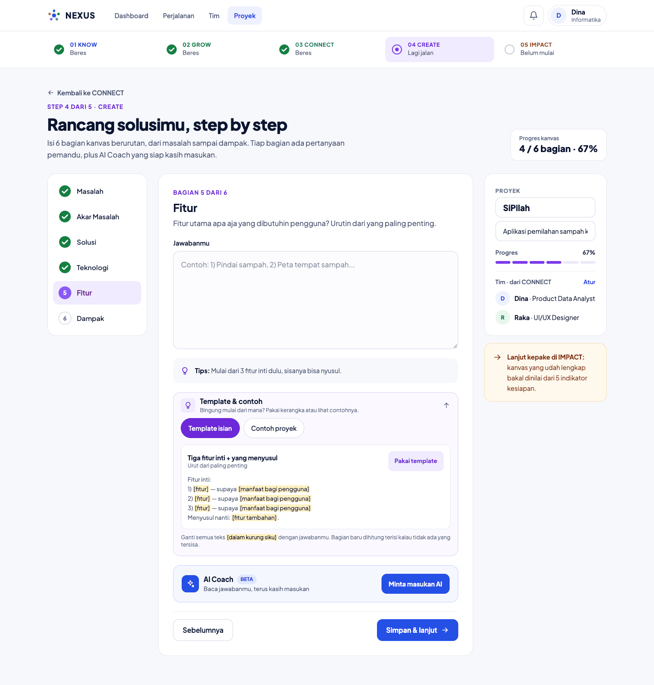 |

**IMPACT · skor kesiapan dengan rumus yang bisa diaudit**

<p align="center">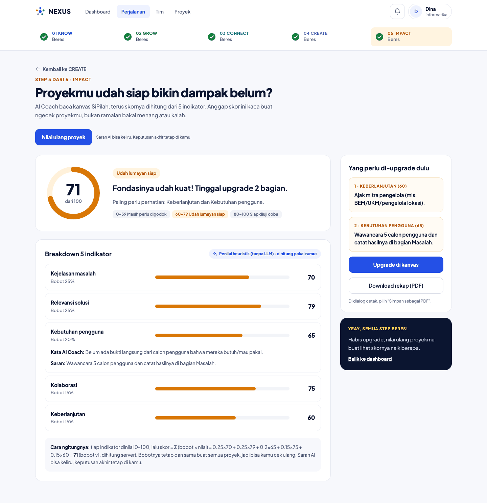</p>

**Mobile-first (390 px)**

<p align="center">
  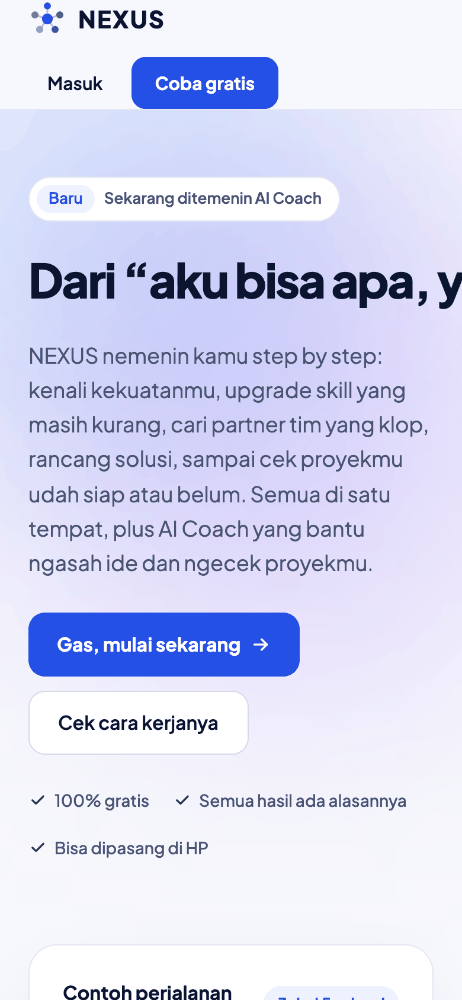
  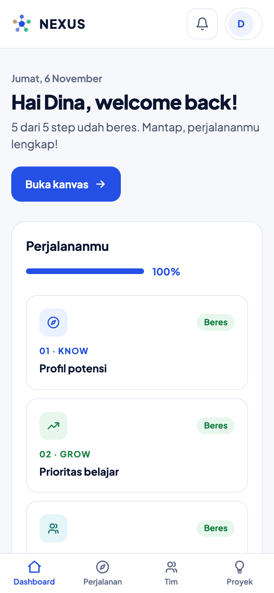
  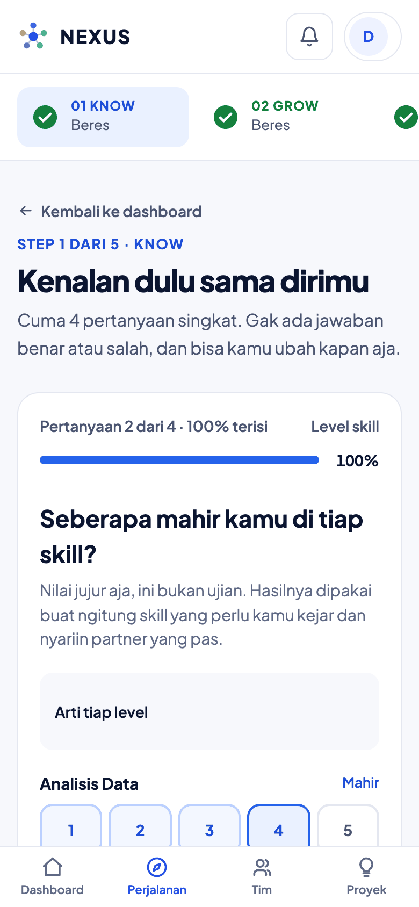
  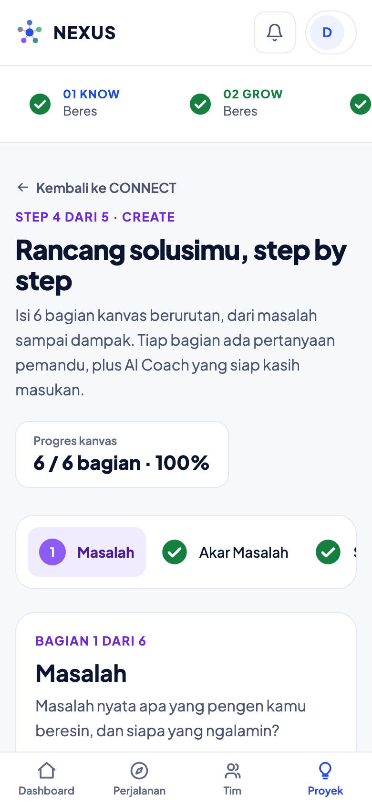
</p>

---

## Masalah, tujuan, dan prinsip produk

**Masalah.** Sumber pengembangan diri (tes minat, kursus, komunitas, lomba) tersebar. Mahasiswa harus menyambungkannya sendiri dan mengulang cerita yang sama di tiap tempat.

**Tujuan MVP**
- Pengguna menyelesaikan kelima langkah dalam satu akun; hasil tiap langkah **otomatis terbawa** ke langkah berikutnya.
- CONNECT mencocokkan **pengguna sungguhan** dari database bersama, bukan data contoh.
- AI Coach memberi masukan pada teks kanvas dan menilai 5 indikator kesiapan dampak.
- Siap diuji ke pengguna nyata untuk validasi sebelum PIMNAS.

**Prinsip produk**
1. **Satu alur, data nyambung** — tidak ada input yang diminta dua kali.
2. **Transparan** — rekomendasi dan skor punya penjelasan "Kenapa hasil ini?"; skor akhir selalu rumus berbobot yang bisa dihitung ulang, AI hanya memberi nilai per indikator.
3. **Privasi by default** — profil privat sampai pengguna menyalakan; yang dikirim ke AI hanya isi kanvas dan peran anggota.
4. **Mobile-first** — semua halaman dapat dipakai di lebar 360 px.

## Target pengguna

| Persona | Siapa | Kebutuhan utama | Langkah terpenting |
| --- | --- | --- | --- |
| **Dina** (utama) | Mahasiswa Informatika semester 5, mau ikut PKM | Tahu kekuatan, cari partner beda jurusan, rancang ide | KNOW, CONNECT, CREATE |
| **Raka** (partner) | Mahasiswa DKV, jago UI/UX | Diajak ke proyek yang cocok dengan skill-nya | CONNECT |
| Pembina (sekunder) | Dosen / pengurus UKM | Lihat progres tim | Dashboard — *fase 2* |

---

## Lima langkah perjalanan

### 01 · KNOW — Profil potensi
Kuis 4 pertanyaan dengan **auto-save** tiap jawaban dan **persentase progres**:
1. **Bidang** — 12 bidang kurasi (Teknologi, Pendidikan, Lingkungan, Kesehatan, Ekonomi Kreatif, Sosial, Pertanian, Kewirausahaan, Keuangan & Fintech, Pariwisata & Budaya, Hukum & Kebijakan, Energi & Kebencanaan).
2. **Skill** — hanya menampilkan **skill paling populer untuk bidang yang dipilih**; semua 33 skill ada di halaman terpisah dengan **pencarian dan filter per bidang**. Tidak ada input bebas.
3. **Seberapa mahir** — setiap skill dinilai sendiri dengan label sehari-hari (*Baru kenal → Bisa ajarin orang*). **Tidak ada level bawaan**; KNOW baru selesai bila semua skill dinilai.
4. **Target setahun** (sampai 3, urutan = prioritas) dan **gaya kerja**.

Hasilnya: label profil (mis. *"Si analis pemecah masalah"*) dan **peran target**. Panel menampilkan 3 peran teratas berikut alasannya; **semua 22 peran** dapat dicari dan dipilih sendiri.

### 02 · GROW — Skill gap & rencana belajar
Membandingkan level kamu dengan tuntutan peran target, diurutkan dengan rumus prioritas (lihat [Rumus](#rumus-penilaian)). Ada tombol **"Kok urutannya gini?"**, checklist rencana belajar (tersimpan, dengan progres %), dan saran peran lain yang cocok. Skill yang tidak dipilih dihitung level 0 ("belum punya"), bukan asumsi.

### 03 · CONNECT — Partner
Rekomendasi partner dari **pengguna lain yang profilnya publik**, diurutkan skor match lengkap dengan kalimat **"Kenapa klop"**. Ajak ke tim → kandidat menerima/menolak; maksimal **5 anggota**; undangan **kedaluwarsa 7 hari**; yang menolak tidak ditawarkan lagi. Pemilik bisa **membatalkan** ajakan.

### 04 · CREATE — Kanvas proyek
Kanvas 6 bagian (**Masalah, Akar Masalah, Solusi, Teknologi, Fitur, Dampak**) dengan pertanyaan pemandu, **auto-save 2 detik**, dan ringkasan tim dari CONNECT. Anggota tim yang menerima bisa melihat dan mengedit.
- **Template & contoh** per bagian: 12 kerangka isian `[kurung siku]` dan 5 tema contoh proyek (ilustrasi). Bagian yang masih berisi placeholder **tidak dihitung terisi**.
- **AI Coach**: masukan *udah oke / bisa ditingkatin / saran versi baru*, atau ide klik-tambah untuk bagian kosong.

### 05 · IMPACT — Skor kesiapan
Aktif setelah 6 bagian terisi. 5 indikator dinilai 0–100 beserta alasan dan saran, skor akhir dihitung **server** dengan bobot tetap, kategori level, **riwayat penilaian**, dan rekap yang bisa dicetak/disimpan sebagai PDF.

---

## Status kebutuhan PRD

✅ selesai · ◐ sebagian · — belum

| ID | Kebutuhan | Prioritas | Status | Catatan |
| --- | --- | :---: | :---: | --- |
| AU-1 | Daftar & login email/password dan Google | P0 | ◐ | Email ✅ (sesi 30 hari). Google siap, aktif bila `AUTH_GOOGLE_*` diisi, **belum diuji** |
| AU-2 | Lengkapi profil sebelum KNOW | P0 | ✅ | Wajib: kampus, jurusan, semester |
| DB-1 | Status 5 step & progres % | P0 | ✅ | Beres / Lagi jalan / Next |
| DB-2 | Kartu "Next step" ke bagian berikutnya | P0 | ✅ | Menunjuk bagian kanvas yang tepat |
| DB-3 | Feed aktivitas (10 terbaru) | P1 | ✅ | |
| KN-1 | Kuis 4 pertanyaan, auto-save | P0 | ✅ | + langkah level skill |
| KN-2 | Profil potensi + peran target | P0 | ✅ | Real-time di panel samping |
| GR-1 | Skill gap, pengguna menilai level sendiri | P0 | ✅ | Dinilai di KNOW |
| GR-2 | Rencana belajar terurut + "Kok urutannya gini?" | P0 | ✅ | |
| CO-1 | Rekomendasi partner dari pengguna lain (publik) | P0 | ✅ | |
| CO-2 | Filter peran tanpa muat ulang | P1 | ◐ | Filter per **skill yang kurang**, bukan per nama peran |
| CO-3 | Ajak → terima/tolak, maks 5 anggota | P0 | ✅ | + batal ajakan, kedaluwarsa 7 hari |
| CR-1 | Kanvas 6 bagian, auto-save 2 detik | P0 | ✅ | |
| CR-2 | Anggota tim otomatis di ringkasan & bisa edit | P0 | ✅ | |
| CR-3 | AI Coach (masukan, "Pakai saran ini", ide) | P0 | ✅ | Gemini; cadangan heuristik |
| IM-1 | AI menilai 5 indikator, hanya bila 6 bagian terisi | P0 | ✅ | |
| IM-2 | Skor = Σ(bobot × nilai), bobot tampil di UI | P0 | ✅ | |
| IM-3 | Riwayat skor & ekspor PDF | P1 | ◐ | Riwayat ✅; PDF lewat cetak browser |
| PR-1 | Visibilitas profil (default privat) | P0 | ✅ | + unduh & hapus data akun |

---

## Arsitektur & teknologi

Satu aplikasi **Next.js (App Router, TypeScript)** menyajikan halaman sekaligus API. Browser tidak pernah menghubungi database atau LLM langsung; semuanya lewat server yang memeriksa sesi dan keanggotaan proyek lebih dulu.

| Lapisan | Pilihan |
| --- | --- |
| Framework | Next.js 15 (App Router) + React 19 + TypeScript |
| UI | Tailwind CSS v4 dengan token design system NEXUS; font Plus Jakarta Sans **di-host sendiri** (`@fontsource-variable`), build tidak bergantung jaringan ke Google |
| Database | MongoDB (Atlas) + Mongoose |
| Auth | Auth.js (next-auth v5) + MongoDB adapter, sesi JWT 30 hari |
| Validasi | Zod (input API dan keluaran AI) |
| AI | Gemini (REST) · Anthropic opsional · penilai heuristik sebagai cadangan |
| PWA | Web manifest, service worker, halaman offline |
| Pengujian | Vitest (unit, build, API), Playwright + axe-core (E2E, aksesibilitas) |

## Model data (MongoDB)

Hasil tiap langkah disimpan di dokumen pengguna atau proyek sehingga langkah berikutnya cukup membaca satu dokumen.

| Koleksi | Isi utama |
| --- | --- |
| `users` | email, nama, kampus, jurusan, semester, `visibility` (`public`/`private`) |
| `profiles` | minat, skill + level 1–5, `goals[]`, gaya kerja, peran target, penanda progres |
| `roles` | 22 peran dan skill yang dituntut (`level`, `weight` 1–3) — data referensi |
| `learningPlans` | butir belajar terurut + centang |
| `projects` | pemilik, anggota (`invited/accepted/declined`), kanvas 6 bagian |
| `aiFeedback` | masukan AI per bagian, di-cache per `inputHash`, mencatat model |
| `assessments` | 5 indikator, skor, level, `weightsVersion`, model |
| `activities` | feed aktivitas dashboard |

Auth.js menambah `accounts`, `sessions`, `verification_tokens` secara otomatis.

## API

Semua route memeriksa sesi (401) dan keanggotaan proyek (403), dan memvalidasi input dengan Zod (400).

| Method | Endpoint | Fungsi |
| --- | --- | --- |
| POST | `/api/register` | Daftar akun |
| GET / PATCH / DELETE | `/api/me` | Profil akun, privasi, ekspor (`?export=1`), hapus akun |
| GET / PUT | `/api/profile` | Jawaban KNOW, level skill, target, peran |
| GET | `/api/roles` | Semua peran + kecocokan dengan profil |
| GET | `/api/grow/plan` | Skill gap + rencana belajar |
| PATCH | `/api/grow/plan/items/:i` | Centang / batal centang |
| GET | `/api/connect/candidates?role=` | Kandidat partner + skor match + alasan |
| GET | `/api/team` | Tim aktif + undangan masuk |
| POST / DELETE | `/api/projects/:id/invites` | Ajak / batalkan ajakan (pemilik) |
| POST | `/api/invites/:id/respond` | Terima / tolak |
| GET / PATCH | `/api/projects/:id/canvas` | Baca / simpan kanvas (anggota) |
| POST | `/api/ai/feedback` | Masukan AI Coach untuk satu bagian |
| GET / POST | `/api/projects/:id/assess` | Riwayat / jalankan penilaian IMPACT |
| GET | `/api/dashboard` | Status 5 step, next step, aktivitas |

## Rumus penilaian

Seluruh perhitungan berjalan di **server** (`src/lib/scoring.ts`), bukan di browser.

**Prioritas belajar (GROW)** — untuk tiap skill *s* yang dituntut peran target, dengan bobot *w* (1 = pelengkap, 3 = inti):

$$\text{prioritas}_s = \max(0,\ \text{target}_s - \text{level}_s) \times w_s$$

**Skor match (CONNECT)** — 80% menutup kekurangan, 20% kesamaan minat (G = skill yang kurang):

$$\text{match} = 80 \cdot \frac{\sum_{s \in G} w_s \cdot \min(\text{gap}_s,\ \max(0,\ \text{level}^{c}_s - \text{level}_s))}{\sum_{s \in G} w_s \cdot \text{gap}_s} + 20 \cdot \frac{|I_u \cap I_c|}{|I_u \cup I_c|}$$

**Kecocokan peran (KNOW)** — 70% skill berbobot dan berlevel, 30% minat:

$$\text{fit} = 0{,}7 \cdot \frac{\sum_s w_s \cdot \min(1,\ \text{level}_s / \text{target}_s)}{\sum_s w_s} + 0{,}3 \cdot \frac{|\text{minat} \cap \text{bidang peran}|}{|\text{bidang peran}|}$$

**Skor kesiapan (IMPACT)** — AI hanya memberi nilai *v* (0–100) per indikator; server menghitung skor:

$$\text{skor} = \sum_{i=1}^{5} b_i \cdot v_i, \qquad \sum b_i = 1$$

| Indikator | Bobot (usulan awal, perlu divalidasi) |
| --- | :---: |
| Kejelasan masalah | 0,25 |
| Relevansi solusi | 0,25 |
| Kebutuhan pengguna | 0,20 |
| Kolaborasi | 0,15 |
| Keberlanjutan | 0,15 |

Level: **0–59** Masih perlu digodok · **60–79** Udah lumayan siap · **80–100** Siap diuji coba. Bobot disimpan per versi (`weightsVersion`).

---

## AI Coach

AI dipakai di dua titik teks bebas: masukan per bagian kanvas (CREATE) dan nilai per indikator (IMPACT). Dipanggil **selalu dari server**.

- **Penyedia**: `AI_PROVIDER` → `GEMINI_API_KEY` (Gemini, default model `gemini-3.5-flash` dengan cadangan `gemini-2.5-flash`) → `ANTHROPIC_API_KEY` → penilai **heuristik** deterministik bila tanpa key.
- **Keluaran terstruktur** (JSON) divalidasi Zod; gagal → coba ulang sekali (pindah ke model cadangan) → pesan *"AI lagi sibuk, coba lagi"* (atau *"Kuota AI lagi penuh"* untuk 429).
- **Cache** per `inputHash`; bagian yang masih memuat `[placeholder]` dijawab tanpa memanggil LLM; bagian kosong hanya memberi ide.
- **Guardrail**: hanya isi kanvas dan peran anggota yang dikirim (tanpa nama/email/kampus); teks kanvas diperlakukan sebagai data, bukan instruksi; batas **20 masukan/jam/pengguna** dan **5 penilaian/proyek/hari**; setiap tampilan AI memuat *"Saran AI bisa keliru. Keputusan akhir tetap di kamu."*; model dan versi prompt dicatat di tiap dokumen.

> **Free tier Gemini**: kuota dihitung **per model per hari** dan kecil. Untuk uji coba/demo aktifkan penagihan pada project Google-nya, atau siapkan beberapa model cadangan di `GEMINI_MODEL=a,b`. Pada tier gratis, Google dapat memakai input untuk meningkatkan produknya (periksa syarat terbaru).

## Privasi, keamanan, aksesibilitas, PWA

- **Privasi**: profil **privat** secara default; pengguna bisa **mengunduh** dan **menghapus** akun beserta datanya. Password di-hash (bcrypt) dan tidak pernah dikembalikan API.
- **Keamanan**: semua route API memeriksa sesi dan keanggotaan; sesi dari akun yang sudah dihapus ditolak; input divalidasi Zod; pilihan bidang/skill hanya dari katalog; secret hanya di environment server.
- **Aksesibilitas**: kontras teks ≥ 4,5:1, target sentuh ≥ 44 px, dapat dipakai dengan keyboard, `prefers-reduced-motion` dihormati — **diverifikasi otomatis** (axe-core, WCAG A/AA, 17 halaman).
- **Mobile-first**: tanpa scroll horizontal di 360 px, navigasi bawah di HP.
- **PWA**: dapat dipasang ke layar utama, service worker meng-cache aset statis dan menampilkan halaman **offline**; **API dan halaman terautentikasi sengaja tidak di-cache** agar data tidak basi atau bocor antar-akun.

---

## Menjalankan secara lokal

Prasyarat: **Node.js ≥ 20** dan MongoDB (Atlas atau lokal).

```bash
npm install
cp .env.example .env.local     # isi MONGODB_URI dan AUTH_SECRET (buat dengan: npx auth secret)
npm run seed                   # isi koleksi `roles` (22 peran)
npm run dev                    # http://localhost:3000
```

Produksi: `npm run build && npm start` (service worker hanya aktif di build produksi).

| Variabel | Fungsi |
| --- | --- |
| `MONGODB_URI` | Koneksi MongoDB (Atlas atau `mongodb://127.0.0.1:27017/nexus`) |
| `AUTH_SECRET` | Rahasia Auth.js |
| `AUTH_GOOGLE_ID` / `AUTH_GOOGLE_SECRET` | Opsional; tanpa ini tombol Google disembunyikan |
| `GEMINI_API_KEY` | AI Coach memakai Gemini ([buat di AI Studio](https://aistudio.google.com/apikey)) |
| `GEMINI_MODEL` | Satu atau beberapa model dipisah koma (default `gemini-3.5-flash,gemini-2.5-flash`) |
| `ANTHROPIC_API_KEY`, `AI_MODEL` | Alternatif penyedia AI |
| `AI_PROVIDER` | Paksa `gemini`, `anthropic`, atau `heuristic` |

Skrip bantu: `npm run seed -- --demo` (4 pengguna demo publik, **hanya dev**), `npm run migrate:levels` (reset level lama; `-- --apply` untuk menerapkan), `npm run docs:screenshots`.

## Deploy ke Vercel

1. **Import repo** di Vercel (framework terdeteksi otomatis: Next.js). Build tidak membutuhkan database maupun koneksi internet ke layanan font.
2. **Environment Variables** (Project → Settings → Environment Variables):

   | Variabel | Wajib | Catatan |
   | --- | :---: | --- |
   | `MONGODB_URI` | ✅ | URI MongoDB Atlas |
   | `AUTH_SECRET` | ✅ | Buat dengan `npx auth secret` (nilai berbeda dari lokal) |
   | `GEMINI_API_KEY` | AI | Tanpa ini AI Coach memakai penilai heuristik |
   | `GEMINI_MODEL` | — | Mis. `gemini-3.5-flash,gemini-2.5-flash` |
   | `AUTH_GOOGLE_ID` / `AUTH_GOOGLE_SECRET` | — | Untuk login Google (tambahkan URL callback `https://<domain>/api/auth/callback/google` di Google Cloud) |

3. **MongoDB Atlas → Network Access**: izinkan `0.0.0.0/0`. Vercel memakai IP dinamis, sehingga allowlist IP tunggal akan membuat semua request gagal.
4. Koleksi `roles` terisi otomatis saat pertama dipakai; `npm run seed` hanya perlu bila ingin mengisinya lebih dulu.
5. Pengaman: `src/auth.ts` memakai konfigurasi lazy dan `src/lib/db.ts` tidak men-cache koneksi yang gagal, sehingga cold start serverless dapat pulih; `npm run test:build` menjaga build tetap lolos tanpa env.

## Pengujian

Semua tes berjalan terhadap **MongoDB sementara di port acak dan build terpisah (`.next-test`)**: tidak menyentuh database di `.env.local` dan tidak mengganggu `npm run dev`. AI pada tes memakai penilai heuristik yang deterministik.

```bash
npm test             # unit → build → API → E2E (±4 menit)
npm run test:unit    # 67 tes: katalog, rumus, template, klien AI (fetch dipalsukan)
npm run test:build   # 4 tes: build hermetik seperti Vercel (lingkungan kosong, DB tak terjangkau, tanpa Google Fonts)
npm run test:api     # 112 tes: seluruh alur PRD lewat HTTP
npm run test:e2e     # 48 tes: Chrome sungguhan — perjalanan lengkap, animasi, offline, WCAG/kontras, mobile 360 px
npm run test:ai-live # opt-in: memanggil Gemini sungguhan (memakai kuota)
```

Prasyarat tes: `mongod` terpasang (atau set `MONGOD_BIN`) dan Google Chrome (dipakai lewat `channel: "chrome"`, tanpa unduh browser).

## Struktur proyek

```
src/
  app/            halaman (landing, auth, onboarding, dashboard, KNOW…IMPACT, pengaturan) + route API
  components/     komponen UI per langkah, navigasi, animasi
  lib/            catalog (katalog kurasi), scoring (rumus), templates, models, services, ai
  auth.ts         konfigurasi Auth.js
public/           service worker dan ikon PWA
scripts/          seed, migrasi, pembuat screenshot
tests/            unit/ · api/ · e2e/ · support/ (stack uji sementara)
docs/screenshots/ gambar untuk README
```

---

## Penyimpangan dari PRD

Keputusan implementasi yang berbeda atau melengkapi PRD:

| Topik | PRD | Implementasi |
| --- | --- | --- |
| Level skill | Pengguna menilai sendiri (GR-1) | Dinilai di KNOW lewat label sehari-hari; **tanpa level bawaan**; skill yang tidak dipilih = level 0 |
| Kosakata minat/skill | Tidak ditentukan | **Katalog kurasi** 12 bidang × 33 skill; tanpa input bebas; populer-per-bidang + halaman pencarian |
| Peran target | Tebakan dari jawaban | 3 rekomendasi beralasan + **semua 22 peran** dapat dicari dan dipilih |
| Target setahun | Pilih satu | Sampai **3**, urutan = prioritas |
| Template kanvas | — | Template & contoh per bagian; placeholder belum diganti ≠ terisi |
| Ekspor PDF | Render di server (react-pdf) | Cetak browser ("Simpan sebagai PDF") |
| Penyedia LLM | Pertanyaan terbuka | Gemini default, Anthropic opsional, cadangan heuristik |
| Undangan 7 hari | "Kedaluwarsa" | Dihitung saat dibaca (tanpa job terjadwal) |
| Satu pengguna, berapa tim? | Pertanyaan terbuka | Satu tim per pengguna |

## Belum dikerjakan & risiko

**Belum / perlu keputusan tim**
- **Login Google** belum diuji (butuh kredensial OAuth).
- **Bobot indikator, rubrik, level & bobot 22 peran, materi belajar, serta isi template/contoh** adalah usulan awal — perlu divalidasi bersama dosen pembina (pertanyaan terbuka PRD).
- **Penilaian AI dengan LLM sungguhan** baru diuji terbatas karena kuota free-tier; validasi selisih skor AI vs dosen (target ≤ 15 poin) belum dilakukan.
- **Observabilitas** (mis. Sentry) dan **rate limit** untuk login/daftar belum ada.
- **Deploy** (Vercel + Atlas) belum dilakukan; uji coba pengguna (SUS ≥ 68, penyelesaian ≥ 60%) belum berjalan.
- **Di luar MVP** (sesuai PRD): panel pembina/dosen, chat, edit kanvas real-time, lebih dari satu proyek aktif, gamifikasi, multi-bahasa, aplikasi native.

**Risiko (dari PRD)**: *cold start* CONNECT (pengguna sedikit → pesan "Ajak temanmu" tampil bila kandidat < 3), nilai AI tidak konsisten (mitigasi: suhu rendah, cache, rubrik), kuota AI habis saat demo (mitigasi: cache, batas laju, model cadangan, siapkan proyek demo).

---

<sub>Team ARUNA · STMIK Widya Utama · PIMNAS 6 2026</sub>
